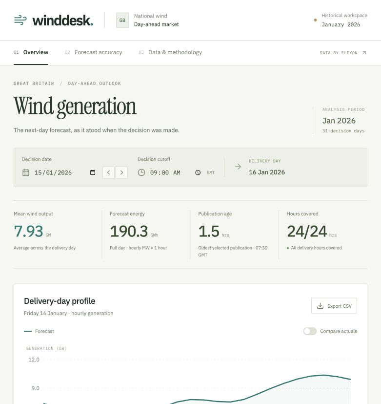

# Wind Desk

A React and Python pilot for reviewing the national wind forecasts available at a historical day-ahead purchase decision, and measuring their subsequent accuracy against Elexon actual generation.

The application includes real downloaded data, historical publication selection, forecast charts, retrospective accuracy analysis, hourly inspection tables, CSV export, a methodology view, and Docker configuration.



## Submission status

- Local application: implemented; Docker startup confirmed by the submitter.
- Frontend: [Live application](https://k7v3m9-frontend.vercel.app).
- Backend: [Python API](https://k7v3m9-backend.vercel.app/docs) · [Health check](https://k7v3m9-backend.vercel.app/api/health).
- Unlisted YouTube video: pending recording and upload; see `docs/DEMO_SCRIPT.md`.
- Public repository: [Arpitm544/k7v3m9](https://github.com/Arpitm544/k7v3m9).
- Submission form: pending the three accessible links above.

The application and API are deployed as separate Vercel projects. The required video and final submission are still outstanding. Do not submit the assignment without the video.

## Run locally

Requirements: Python 3.12, Node.js 22 or later, and npm. The small historical snapshot is included; Elexon connectivity is not required to run the app.

From the repository root:

```sh
python3.12 -m venv .venv
source .venv/bin/activate
python -m pip install -r backend/requirements.txt
python -m uvicorn backend.app.main:app --reload --port 8000
```

In another terminal:

```sh
cd frontend
npm ci
npm run dev
```

Open http://localhost:5173. Vite proxies `/api` requests to port 8000. API documentation is at http://localhost:8000/docs.

If using uv instead of a separately installed Python:

```sh
uv venv --python 3.12 .venv
uv pip install --python .venv/bin/python -r backend/requirements.txt
.venv/bin/python -m uvicorn backend.app.main:app --port 8000
```

## Run with Docker

Start Docker Desktop or another Docker daemon, then from the repository root:

```sh
docker compose up --build
```

Open http://localhost:8080. Nginx serves the production React build and forwards `/api` to the Python container. Backend health must pass before the frontend starts. Stop with `docker compose down`.

Compose configuration validation passes. The submitter subsequently confirmed that the Docker application builds and starts successfully. Recheck both application views and the health endpoint before submission.

## Checks

```sh
.venv/bin/python -m pytest backend/tests -q
npm run build --prefix frontend
docker compose config --quiet
```

The suite contains deterministic synthetic cases and integration checks against the included snapshot. It covers cutoff inclusion, later-revision exclusion, per-target selection, missing actual half-hours, zero generation, actual revisions, duplicate conflicts, aggregate weighting, date boundaries, timezone normalization, API validation, and no-lookahead checks across all January days at three cutoffs.

## Product workflow

1. Select a January decision date and a cutoff in Europe/London.
2. Inspect the next delivery day's forecast, publication times, age, and coverage.
3. Enable **Compare actuals** to reveal observations and errors retrospectively.
4. Open **Forecast accuracy** to evaluate all January decision dates with the same chosen cutoff.
5. Open **Data & methodology** for source links, formulas, assumptions, and snapshot provenance.

CSV export contains the displayed forecast fields. Actuals and errors are included only when retrospective comparison is enabled. Daily accuracy table entries open the corresponding decision with actuals enabled.

## Time and data semantics

**Decision dates:** 1–31 January 2026 inclusive. **Delivery dates:** 2 January–1 February 2026 inclusive. This follows the brief's wording about decisions made in January rather than interpreting it as January delivery dates.

**Cutoff:** 09:00 Europe/London by default, configurable by the user. This is a demonstration assumption, not a claim about an auction's official deadline. January UK local time is GMT. Internally all timestamps are timezone-aware UTC.

**Selection:** for each next-day target hour, select the largest `publishTime` less than or equal to the selected decision timestamp. Publication time is a proxy for availability; the API does not establish the utility's actual receipt time. If no eligible forecast exists, keep it missing. Never substitute a later publication. Different targets can legitimately select different publication times; the API exposes the earliest and latest selected publications.

**Resolution:** the actual downloaded WINDFOR records are hourly, although the brief describes `startTime` as similar to half-hourly actuals. Compare the forecast at hour H against the mean of actuals at H and H+30 minutes. This assumes the hourly forecast is representative of that hour. No synthetic half-hour forecast or interpolation is created. A stricter interpretation of forecast interval semantics should be agreed with the client before operational use.

**Actuals:** FUELHH filtered to `fuelType=WIND`. Use the latest available actual publication per half-hour. Both half-hours must exist for an hourly actual to be computed. Actuals are used only for retrospective evaluation, not historical buying recommendations. Scope and measurement differences between the assigned datasets may contribute to the measured differences; these are not necessarily pure forecasting errors.

**Expected coverage:** 31 delivery days × 24 hours = 744 hourly comparisons, based on 1,488 actual half-hours. Missing values stay null, chart lines show gaps, error metrics use matched pairs only, and coverage reports their denominator. Partial energy totals must not be interpreted as full-day totals.

## Metrics

For each matched hour, `e = forecast MW - actual MW`:

| Metric | Definition | Interpretation |
|---|---|---|
| MAE | mean of absolute e | Typical absolute miss in MW |
| RMSE | square root of mean e squared | Emphasizes large misses, in MW |
| Bias | mean e | Positive means wind overprediction |
| Coverage | matched hours / expected hours | Completeness of the comparison |
| Forecast energy | sum of hourly MW × 1 hour | MWh, labeled partial if incomplete |

Range-wide metrics are computed directly from all matched intervals. Daily RMSE values are not averaged together. Empty matched sets yield null metrics. MAPE is intentionally omitted because low actual generation can make percentage errors misleading.

At the default 09:00 cutoff, the included snapshot gives:

| Measure | Result |
|---|---|
| Matched hourly pairs | 744 / 744 |
| MAE | 2,038.91 MW |
| RMSE | 2,504.76 MW |
| Bias | +1,747.89 MW |
| Largest daily MAE | 5,374.79 MW, decision on 27 Jan for delivery on 28 Jan |
| Largest absolute hourly error | 6,870 MW, delivery on 12 Jan at 01:00 GMT |

These are descriptive historical results under the stated alignment and cutoff assumptions. They are not a calibrated confidence interval or guaranteed future error. The dashboard labels month-wide accuracy as retrospective, including when shown alongside an earlier decision date.

## Refresh the historical snapshot

From the repository root:

```sh
python scripts/fetch_data.py
```

The script uses Python's standard library and retrieves public Elexon data. It requests forecast publications from 30 December 2025 through 31 January 2026, and actual deliveries from 2 January through 1 February. Overlapping chunk boundaries are deduplicated by target and publication timestamp. Differing values for the same key fail ingestion rather than being chosen arbitrarily. Unexpected forecast cadence also fails ingestion for manual review.

Requests have timeouts, bounded retries, and at most four concurrent downloads. Nothing is replaced until downloads and validation succeed. The saved normalized payload has a SHA-256 digest; the backend checks it before serving. Restart the backend after refreshing, because it caches a verified snapshot in memory.

`backend/data/manifest.json` records download time, source request URLs, row counts, deduplication/conflict counts, resolution, and checksum. The snapshot contains 19,272 forecast records and 1,488 actual half-hours. Normalized data is retained as a small gzip file, with all downloaded forecast versions preserved. There is no generated or simulated business data in the application.

Sources:

- [Elexon WINDFOR stream documentation](https://bmrs.elexon.co.uk/api-documentation/endpoint/datasets/WINDFOR/stream)
- [Elexon FUELHH stream documentation](https://bmrs.elexon.co.uk/api-documentation/endpoint/datasets/FUELHH/stream)
- [Elexon API developer portal and data terms](https://developer.data.elexon.co.uk/)

## Architecture and directory map

```text
frontend/                    React + TypeScript application
  src/main.tsx               Views, controls, charts, data tables, API state
  src/styles.css             Responsive layout and visual design
  vite.config.ts             React build and local API proxy
  nginx.conf                 Docker production static serving and API proxy
  Dockerfile                 Frontend production image
backend/
  app/analytics.py           Pure historical selection and metric calculations
  app/main.py                Validated FastAPI routes and cached snapshot loader
  data/snapshot.json.gz      Versioned normalized Elexon records
  data/manifest.json         Provenance and checksum
  tests/                     Deterministic analytics and API integration tests
  index.py                   Vercel Python entrypoint
  vercel.json                Include snapshot files in deployed function
  requirements.lock          Exact tested dependency versions
  requirements.txt           Same pinned versions flattened for Vercel compatibility
  Dockerfile                 Python API image
scripts/fetch_data.py         Offline public-data ingestion
scripts/check_snapshot.py     Independent snapshot verification
scripts/check_local.sh        Local proxy/API smoke check
scripts/dev.sh                Start local API and frontend together
docs/DEMO_SCRIPT.md           Customer and technical video outline
docs/SUBMISSION_CHECKLIST.md  Publication and final access checklist
docs/BRANCHES.md              Six-part source organization and branch dependencies
IMPLEMENTATION_PLAN.md       Original proposed plan; actual cadence differs
.env.example                 Environment variable documentation
docker-compose.yml           Frontend and backend local orchestration
```

No database is required for this fixed historical window. The offline downloader owns upstream access; API requests are fast and independent of Elexon availability. The frontend aborts obsolete requests when controls change and displays loading/failure states rather than showing stale values under new controls.

## API

| Endpoint | Purpose |
|---|---|
| `GET /api/health` | Checks that the snapshot can load and verify |
| `GET /api/metadata` | Data provenance, resolution, assumptions, default-cutoff quality |
| `GET /api/decision?date=2026-01-15&cutoff=09:00` | Next-day forecast selection and retrospective observations |
| `GET /api/accuracy?from=2026-01-01&to=2026-01-31&cutoff=09:00` | Daily and aggregate errors for inclusive decision dates |

Dates outside January, reversed date ranges, and malformed cutoffs return HTTP 422. Snapshot failures return HTTP 503. The API contains historical public data and has no authentication or trading actions.

## Deploy to Vercel

Use two projects from the same repository so the required React and Python services remain independent.

1. Create a Vercel project with root directory `backend`. Vercel detects the FastAPI `app` exported by `index.py`. Use Python 3.12; `requirements.txt` contains the same pinned versions as the lock file and `vercel.json` includes the data files.
2. Check `https://YOUR-BACKEND.vercel.app/api/health` and `/api/metadata`. Confirm the snapshot loads before moving on.
3. Create a frontend Vercel project with root directory `frontend`, framework Vite, build `npm run build`, output `dist`.
4. Set frontend build variable `VITE_API_URL=https://YOUR-BACKEND.vercel.app` without a trailing slash, then deploy.
5. Set backend `ALLOWED_ORIGINS=https://YOUR-FRONTEND.vercel.app` and redeploy the backend. Add other exact origins only if needed. Do not include a trailing slash or a path.
6. Verify both views and the real API connection on the deployed frontend. Disable deployment protection for submission access if needed, then verify the final links in an incognito window.
7. Replace the pending deployment and video entries at the top of this README with verified links.

Docker is used for local reproducibility; Vercel runs the Python function and Vite assets using its own supported runtimes, not these Docker images. No ingestion runs on function requests or writes to the deployed filesystem.

## Deliberate limits

This is an analytical pilot, not a trading system. No demand, price, weather, other renewable source, market order, or financial saving is modeled. The data cannot determine this utility's procurement requirement. Forecast scope, interval semantics, decision cutoff, and data receipt latency need client validation before operational use.

The frontend uses Google Fonts with local sans-serif fallbacks. There is no required external font dependency for functionality. Historical data remains usable offline after installation.

## AI assistance

OpenAI Codex was used to help interpret the brief, research public documentation, plan the architecture, write and revise code, download and inspect the public data, build tests, and prepare documentation. The included business data comes from Elexon; it was not generated by AI. The submitter should review the implementation and be able to explain the methodology and tradeoffs in the required technical presentation.
